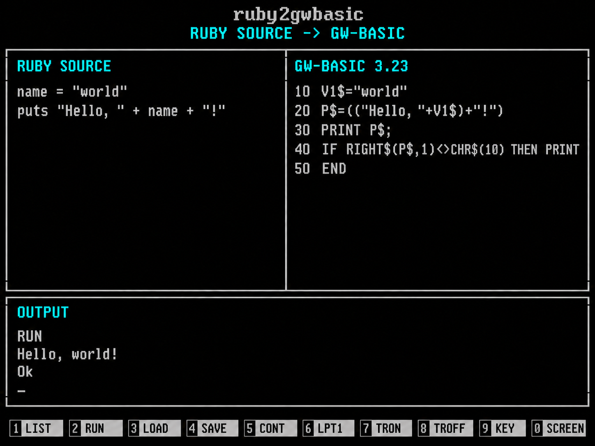
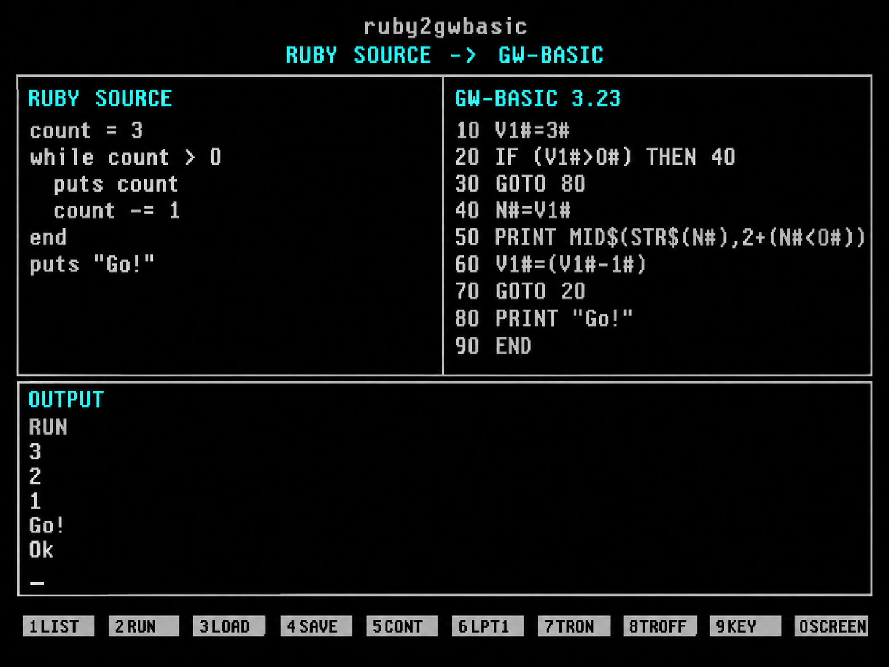

# ruby2gwbasic

A small, dependency-free Ruby-to-GW-BASIC converter written in Rust. It parses a
deliberately limited Ruby subset and emits an ASCII BASIC listing with line
numbers, starting at 10 and increasing by 10.

## Conversion screenshots

Generated illustrations in the style of the classic GW-BASIC screen. Each shows
Ruby source, the converter's actual numbered BASIC output, and the program's
console output.

**Hello, world!**



**A countdown loop**



The image generation prompts are saved in [docs/images/prompts](docs/images/prompts).

## Run

Requires Rust 1.85 or newer.

```sh
cargo run -- examples/hello.rb
cargo run -- examples/countdown.rb -o countdown.bas
cargo run -- examples/fizzbuzz.rb -o fizzbuzz.bas
printf 'puts "Hello from Ruby!"\n' | cargo run --quiet
```

Build an executable with `cargo build --release`, or install locally with
`cargo install --path .`. Run `ruby2gwbasic --help` for CLI options. An omitted
input filename, or `-`, reads stdin; output defaults to stdout. Conversion errors
include the source filename, line, and column, return a nonzero exit status, and
leave an existing output file untouched.

Load the generated ASCII file in GW-BASIC with `LOAD "COUNTDOWN.BAS"`, then
`RUN`. Transfer the file into your DOS environment first.

## Example

Ruby:

```ruby
count = 3
while count > 0
  puts count
  count -= 1
end
puts "Go!"
```

Generated GW-BASIC:

```basic
10 V1#=3#
20 IF (V1#>0#) THEN 40
30 GOTO 80
40 N#=V1#
50 PRINT MID$(STR$(N#),2+(N#<0#))
60 V1#=(V1#-1#)
70 GOTO 20
80 PRINT "Go!"
90 END
```

## Supported Ruby

- Local assignments: `=`, `+=`, `-=`, `*=`, `/=`, `%=`.
- Integer and decimal literals, parentheses, unary `+`/`-`, and `+ - * / %`.
- ASCII single- and double-quoted strings, string concatenation with `+`.
  Double-quoted strings support `\n`, `\r`, `\t`, `\"`, and `\\`;
  single-quoted strings support `\'` and `\\` and preserve other backslashes.
- `puts` and `print`, with comma-separated arguments and optional call
  parentheses. `puts` prints each argument on its own line; `print` adds no
  newline. Empty `puts` prints a blank line.
- Nested `if` / `elsif` / `else` / `end` and `while` / `end` blocks.
- Conditions using `== != < <= > >=`, `true`, `false`, `!`, `&&`, and `||`.
  Logical operators preserve short-circuit evaluation.
- Blank lines, `#` comments, LF or CRLF source files, and a final line without
  a newline.

One statement per line; block headers end at the newline, without `then` or
`do`. Expressions and strings must fit on one source line. Variable names start
with a lowercase ASCII letter or underscore and continue with ASCII letters,
digits, or underscores. Names are mapped to `V1#`, `V2$`, etc., preserving Ruby's
case sensitivity and avoiding BASIC keywords. `N#` and `P$` are output temporaries.

## Boundaries

This is a transpiler for small procedural scripts, not a Ruby runtime. Methods,
classes, arrays, hashes, blocks, ranges/`for`, input, interpolation, `nil`, boolean
variables, dynamic type changes, and arbitrary method calls are unsupported.
Unsupported syntax is an error. Variables must keep their original integer,
float, or string type and be assigned on every control-flow path before use.
Conditions require booleans or comparisons; implicit Ruby truthiness is rejected.

Numeric variables use BASIC double precision. Integer `/` uses `INT(a/b)` to
preserve Ruby's floor division, including negative operands; `%` uses
`a-b*INT(a/b)`. Mixed integer/float arithmetic produces a float. Arbitrary-size
Ruby integers are unavailable: integer literals above `2^53 - 1` are rejected,
and arithmetic remains subject to BASIC rounding, precision, and overflow.
Decimal literals use ordinary notation (`1.5`), without exponents or underscores.
Division by zero follows BASIC's runtime error behavior.

Numeric printing uses BASIC's `STR$` formatting with the positive sign space
removed. Float spelling and scientific notation may differ from Ruby (`1.0`
can print as `1`). Newlines and control characters follow BASIC's console
behavior; `puts` avoids adding a newline to strings already ending in LF.
Strings and concatenation results are limited to 255 bytes by the target runtime.
Generated lines longer than 255 bytes and programs needing line numbers above
65529 are rejected. Large expressions may need to be split into assignments.

## Library and development

```rust
let listing = ruby2gwbasic::convert("puts 'Hello!'\n")?;
assert_eq!(listing, "10 PRINT \"Hello!\"\n20 END\n");
# Ok::<(), ruby2gwbasic::Error>(())
```

The implementation has three stages: tokenization, parsing into an AST, and
typed code generation with a final label-to-line-number pass.

```sh
cargo test
cargo clippy --all-targets -- -D warnings
cargo fmt --check
```

For an optional execution check, install `pcbasic` in a Python virtual
environment, ensure Ruby is on your PATH, and run
`python scripts/verify_runtime.py`. It compares Ruby output against generated
listings executed in PC-BASIC for all examples, signed division/modulo,
short-circuit conditions, strings, and operator precedence. PC-BASIC is a
development-only check; the Rust converter has no third-party dependencies.

The target syntax follows Microsoft's [GW-BASIC User's Guide](https://gw-basic.netlify.app/files/tuts/gw-man/)
(archived manual), including its [PRINT](https://gw-basic.netlify.app/files/tuts/gw-man/print),
[IF](https://gw-basic.netlify.app/files/tuts/gw-man/if), and
[INT](https://gw-basic.netlify.app/files/tuts/gw-man/int) references.
